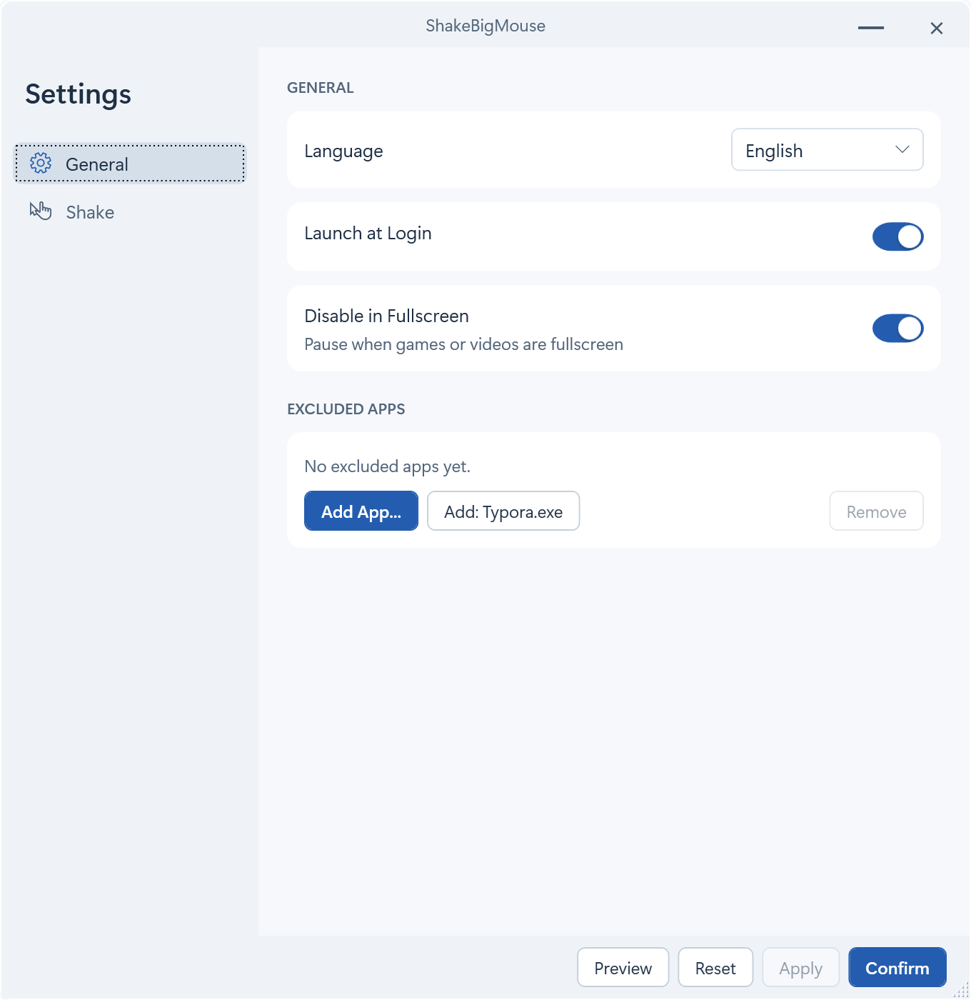
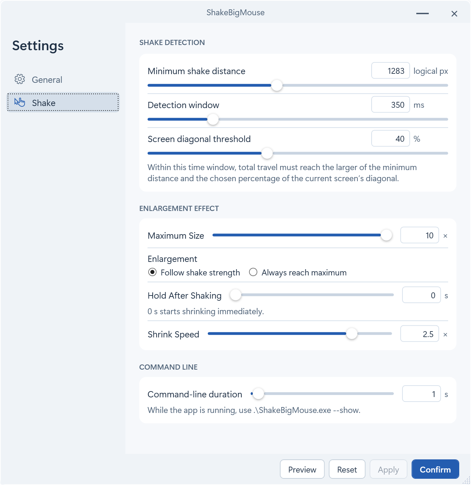

# ShakeBigMouse

English · [简体中文](README.zh-CN.md)

Shake the mouse to enlarge the pointer on Windows, just like on macOS.

## Getting started

Run `ShakeBigMouse.exe`, then shake the mouse to enlarge the pointer.


### Command line

While the app is running, use `ShakeBigMouse.exe --show` to enlarge the pointer without shaking the mouse. The pointer stays at its maximum size for the duration set under **Shake → Command line**, then shrinks back.

## Settings

Open **Shake** in Settings. By default, the harder you shake the mouse, the larger the pointer grows, up to 10× its normal size. Choose **Always reach maximum** to get the same size with every shake.

| Setting | Default | Description |
| --- | --- | --- |
| Minimum shake distance | 1283 logical pixels | Counts the total distance the pointer travels back and forth. Lower this if short shakes rarely trigger the effect. |
| Screen diagonal threshold | 40% | A percentage of the current monitor’s diagonal. The pointer must travel at least the greater of this distance and the minimum shake distance. |
| Detection window | 350 ms | |
| Hold After Shaking | 0 s | |
| Shrink Speed | 2.5× | |





## Building on Windows

Install the .NET 10 SDK and PowerShell 7 on Windows, then run these commands to build and verify the ZIP package.

```powershell
pwsh -File ./scripts/Publish-Windows.ps1
pwsh -File ./scripts/Test-WindowsPackage.ps1 -ZipPath ./dist/windows/ShakeBigMouse-win-x64.zip
```

## License

[MIT](LICENSE). Based on [nowonderwhyy/shake-to-find-cursor](https://github.com/nowonderwhyy/shake-to-find-cursor).
