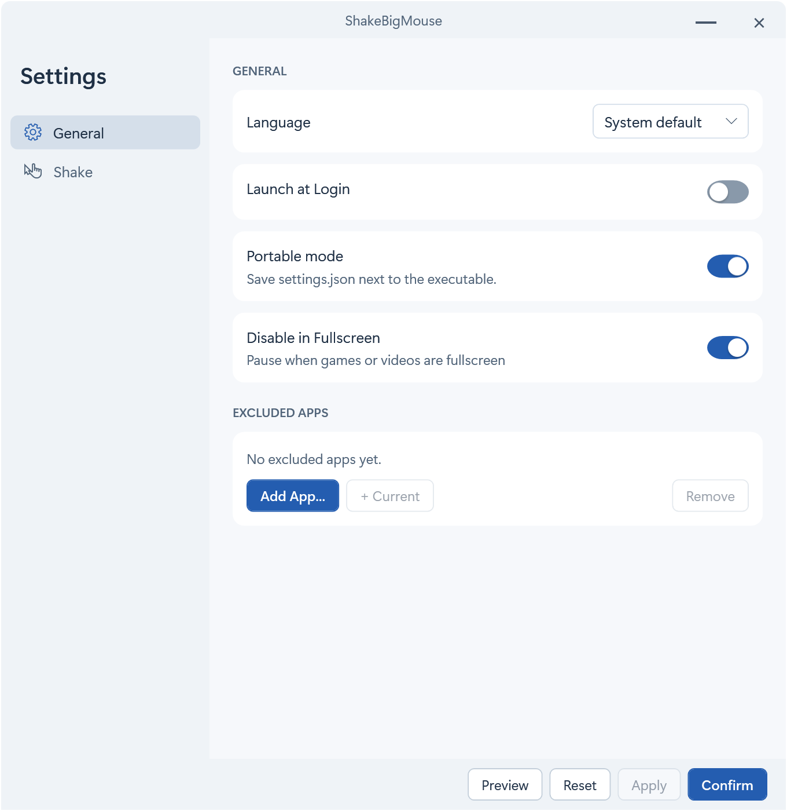
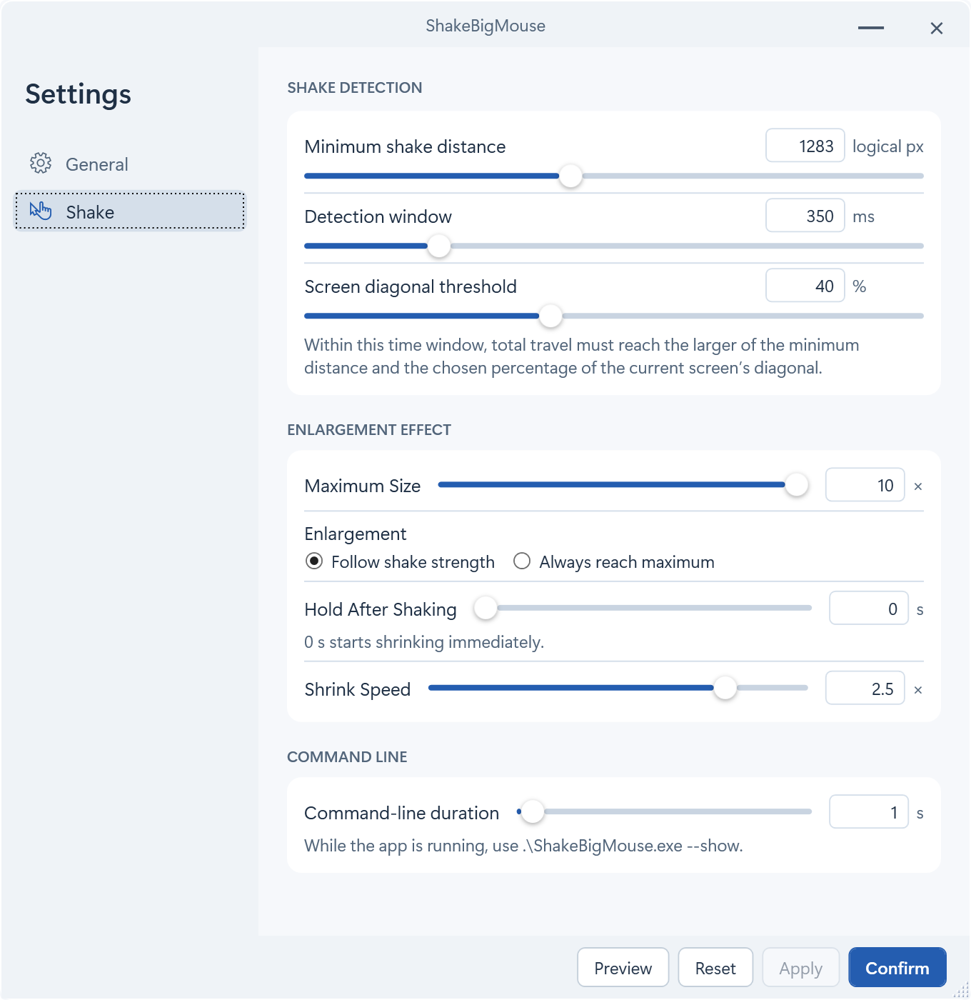

# ShakeBigMouse

[English](README.md) · 简体中文

在Windows上实现macOS上晃动鼠标放大效果

## 开始使用

按需选择 Windows x64 压缩包。

| 下载文件 | 运行条件 |
| --- | --- |
| `ShakeBigMouse-win-x64.zip` | 自带 .NET 运行时，解压即可使用。 |
| `ShakeBigMouse-win-x64-framework-dependent.zip` | 电脑需安装 .NET 10 桌面运行时（x64）。 |

解压后双击运行 `ShakeBigMouse.exe`，来回晃动鼠标即可放大指针。


### 命令行调用

运行 `ShakeBigMouse.exe --show`, 可通知已有实例放大指针, 无需晃动指针会放大到设置中的最大尺寸, 按`晃动 → 命令行`中的持续时间保持后正常缩回.

## 参数设置

打开设置里的`晃动`. 默认情况下, 晃动幅度越大, 指针就放得越大, 最高 10 倍. 如果每次都想得到同样大的指针, 可以选 "始终放大到最大尺寸".

| 设置 | 默认值 | 说明 |
| --- | --- | --- |
| 最小抖动距离 | 1283 逻辑像素 | 轻晃时很难触发, 可以调低. 计算移动总距离. |
| 屏幕对角线比例 | 40% | 按指针所在屏幕的对角线计算. 取和`最小抖动距离`的最大值 |
| 检测时间窗口 | 350 毫秒 |  |
| 停止晃动后保持 | 0 秒 |  |
| 缩小速度 | 2.5 倍 |  |





## Windows 构建

在 Windows 上安装 .NET 10 SDK 和 PowerShell 7，然后运行以下命令构建并验证两种 ZIP。每个包内只有 `ShakeBigMouse.exe`。

```powershell
pwsh -File ./scripts/Publish-Windows.ps1
pwsh -File ./scripts/Test-WindowsPackage.ps1 -ZipPath ./dist/windows/ShakeBigMouse-win-x64.zip
pwsh -File ./scripts/Test-WindowsPackage.ps1 -ZipPath ./dist/windows/ShakeBigMouse-win-x64-framework-dependent.zip -FrameworkDependent
```

## 许可证

[MIT](LICENSE). 基于 [nowonderwhyy/shake-to-find-cursor](https://github.com/nowonderwhyy/shake-to-find-cursor) 开发.
